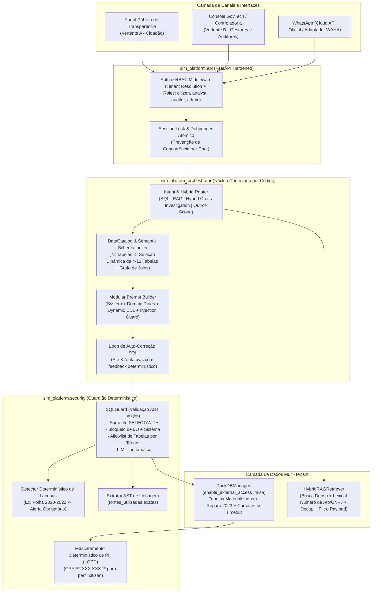

# ARCHITECTURE — Estratégia de Produto (Vertentes A e B), Viabilidade Comercial GovTech, Avaliação Tecnológica e Arquitetura-Alvo Multi-Tenant

Este documento consolida a visão estratégica de produto (Partes II e III da missão), a avaliação comparativa de tecnologias e a especificação da arquitetura-alvo implementada em `/home/antigravity/sim-workspace/sim_platform`.

---

## 1. Análise Estratégica das Duas Vertentes de Negócio

### 1.1. Comparativo Estrutural: Vertente A (Cidadão / B2C / Cívica) vs. Vertente B (Prefeituras / B2G SaaS)

| Dimensão | Vertente A — Democratização de Dados Públicos | Vertente B — Plataforma GovTech de Inteligência Municipal |
|---|---|---|
| **Público-Alvo Principal** | Cidadãos, jornalistas investigativos, vereadores (oposição/fiscalização), observatórios sociais, pesquisadores e ONGs. | Controladores internos, secretários de Fazenda/Planejamento/Saúde/Educação, procuradores, gestores de contratos, ouvidores e técnicos de contabilidade. |
| **Proposta de Valor Central** | *"Entenda como o dinheiro da sua cidade é gasto fazendo perguntas simples no WhatsApp ou na Web, sem precisar saber contabilidade pública."* | *"Copiloto de inteligência fiscal, contratual e normativa auditável que cruza SICOM, ERP, Portal da Transparência e Diário Oficial em segundos."* |
| **Canal Primário de Acesso** | **Web Pública Indexável (SEO)** como canal primário de descoberta + **WhatsApp Oficial** como canal de conveniência. *(Ver análise crítica abaixo sobre o WhatsApp).* | **Portal Web SaaS Administrativo (Desktop-first)** com painéis, relatórios exportáveis, trilha de auditoria e alertas no **WhatsApp/E-mail** para gestores. |
| **Nível de Detalhe da Resposta** | Linguagem cidadã traduzida, síntese executiva, gráficos simples, **CPFs mascarados (LGPD)** e citação amigável das fontes. | Linguagem técnica precisa, tabela completa, exportação CSV/XLSX/PDF, **SQL visível e auditável**, códigos de natureza/fonte de recurso e link direto ao ato no Diário Oficial. |
| **Tolerância a Erro / Alucinação** | Baixa (erro gera desinformação pública ou crise política). | **Zero** (erro em parecer de controladoria ou prestação de contas ao TCE gera responsabilização administrativa/multa ao gestor). |
| **Modelo de Monetização** | Baixo potencial de cobrança direta ao cidadão. Financiável via editais de fomento, fundações cívicas, imprensa, câmaras municipais ou como **módulo público ("Portal da Transparência Conversacional") vendido dentro da Vertente B para a Prefeitura cumprir critérios do Selo Diamante ATRICON**. | **Alto potencial B2G recorrente (SaaS anual/mensal)**: assinatura por porte populacional do município, contratável via Dispensa por Valor (Art. 75, II da Lei 14.133/2021 — até R$ 65.492,11/ano em 2026, ou R$ 130.984,20/ano via Consórcio Intermunicipal) ou CPSI (Marco Legal das Startups, LC 182/2021). |

### 1.2. Questionamento Estratégico: O WhatsApp deve continuar sendo o canal principal na Vertente A?
**Não como canal único nem primário isolado.**
1. **Limitações estruturais do WhatsApp**:
   - Não é indexável por mecanismos de busca (Google), desperdiçando o maior vetor de aquisição orgânica de cidadãos que pesquisam *"salário prefeito Caeté"*, *"contratos limpeza urbana Caeté"* ou *"lei X Caeté"*.
   - É inadequado para tabelas com múltiplas colunas, séries históricas de 5 anos ou comparação de indicadores orçamentários.
   - Impõe custo por janela de conversação na API Oficial da Meta e risco de bloqueio de número caso se utilize automação não-oficial (WAHA).
2. **Posicionamento Recomendado**:
   - **Interface Web Pública + API Aberta** como vitrine principal da Vertente A (com URLs compartilháveis para cada consulta auditada), mantendo o **WhatsApp como canal complementar de engajamento rápido e envio de alertas**.

---

## 2. Descoberta de Oportunidades de Negócio na Gestão Municipal (Seção 5.1)

Diferenciamos abaixo **consultas meramente curiosas** de **processos administrativos críticos** que hoje consomem dezenas de horas de servidores cruzando planilhas do ERP, pacotes do TCE e edições em PDF do Diário Oficial.

### Oportunidade 1 — Auditoria Contínua de Contratos, Aditivos e Saldo de Empenhos (Controladoria e Gestão de Contratos)
1. **Quem é o usuário**: Controlador Interno Municipal, Gestor de Contratos e Fiscais de Contrato das Secretarias.
2. **Qual problema enfrenta**: Hoje, os dados de execução financeira (`empenho`, `liquidacao`, `pagamento`) ficam no sistema contábil, os instrumentos contratuais em outra aba (`contratos`, `termo_aditivo_contrato`) e as portarias de designação de fiscais e extratos publicados ficam espalhados em PDFs do Diário Oficial. O controlador não consegue responder rapidamente quais contratos vigentes já consumiram >80% do saldo empenhado, quais sofreram aditivos acima de 25% (limite do Art. 125 da Lei 14.133/2021) ou quais estão sem publicação de extrato no Diário Oficial.
3. **Como resolveria utilizando a plataforma**: Consulta cruzada híbrida (SQL + RAG) e painel de alertas automáticos: *"Liste os contratos vigentes com pagamentos acumulados acima de 80% do valor contratado ou aditivos superiores a 25% e verifique se o extrato do termo aditivo foi publicado no Jornal Opinião"*.
4. **Quais dados seriam necessários**: `contratos`, `termo_aditivo_contrato`, `fornecedor_contrato`, `empenho_contrato`, `empenho`, `pagamento` + coleção `jornais_caete` (`tipo_ato IN ('EXTRATO CONTRATUAL', 'TERMO ADITIVO')`).
5. **Benefício mensurável**: Redução de ~85% no tempo de preparação de auditorias trimestrais de controle interno (de 5 dias úteis para <2 horas) e prevenção de apontamentos/multas do TCE-MG por pagamento sem cobertura contratual ou falta de publicidade.
6. **Dificuldade de implementação**: **Baixa/Média** (todas as bases já existem no repositório atual; requer apenas o orquestrador híbrido determinístico implementado em `sim_platform`).
7. **Por que uma prefeitura pagaria por isso**: Multas do TCE recaem sobre o CPF do Prefeito, do Ordenador de Despesas e do Controlador Interno. Uma ferramenta que evita glosas e apontamentos de irregularidade contratual se paga no primeiro risco evitado.

### Oportunidade 2 — Monitoramento Automático de Índices Constitucionais e Fiscais (Planejamento, Fazenda e Saúde/Educação)
1. **Quem é o usuário**: Secretário da Fazenda, Contador Municipal, Secretário de Educação e Secretário de Saúde.
2. **Qual problema enfrenta**: O município tem obrigação constitucional de aplicar no mínimo **25% da receita resultante de impostos na Manutenção e Desenvolvimento do Ensino — MDE** (Art. 212 CF) e **15% em Ações e Serviços Públicos de Saúde — ASPS** (LC 141/2012), além de respeitar o limite prudencial de **51,3% / 54% da RCL com despesa de pessoal no Executivo** (LRF). Acompanhar a pressão sobre a receita (`ISF-M`), o esforço social (`IES-C`) e o ritmo de liquidação (`IEQ-C`) por fonte de recurso exige cruzamentos complexos entre `receita_orcamentaria_municipio`, `empenho_fonte`, `liquidacao_fonte` e `pagamento_fonte`.
3. **Como resolveria utilizando a plataforma**: Consultas naturais auditáveis e relatórios executivos mensais: *"Qual a evolução da execução por função Saúde (10) e Educação (12) frente à receita arrecadada em 2024 e 2025, separando recursos próprios (Fonte 1500) de transferências vinculadas?"*.
4. **Quais dados seriam necessários**: `receita_orcamentaria_municipio`, `detalhamento_receita_municipio`, `empenho`, `empenho_fonte`, `liquidacao`, `pagamento`, `funcao_governo_municipio`, `fonte_recurso_municipio`.
5. **Benefício mensurável**: Economia de 20 a 40 horas/mês da equipe contábil na montagem de quadros gerenciais para reuniões de secretariado e audiências públicas quadrimestrais da LRF.
6. **Dificuldade de implementação**: **Baixa** (dados já modelados no SICOM; exige reparo da corrupção de 2023 já implementado).
7. **Por que uma prefeitura pagaria por isso**: A rejeição de contas por descumprimento dos mínimos constitucionais de Saúde/Educação gera **inelegibilidade do Prefeito** (Lei da Ficha Limpa).

### Oportunidade 3 — Prevenção de Fracionamento Indevido de Despesa em Dispensas de Licitação (Compras e Procuradoria)
1. **Quem é o usuário**: Agente de Contratação / Pregoeiro, Secretário de Administração e Procurador Municipal.
2. **Qual problema enfrenta**: Pela Lei 14.133/2021 (Art. 75, § 1º), o limite de dispensa por valor (R$ 65.492,11 para compras/serviços em 2026) deve considerar o **somatório do que for despendido no exercício financeiro pela respectiva unidade gestora com objetos de mesma natureza (ramo de atividade)**. Quando diferentes secretarias solicitam compras diretas ao longo do ano, o setor de compras frequentemente ultrapassa o teto sem perceber, configurando **fracionamento ilícito de despesa**.
3. **Como resolveria utilizando a plataforma**: Consulta instantânea antes de autorizar nova compra direta: *"Quanto já foi dispensado ou empenhado por dispensa em 2025 para objetos de manutenção predial ou informática e quais fornecedores mais receberam por dispensa?"*.
4. **Quais dados seriam necessários**: `dispensa_inexigibilidade`, `item_dispensa`, `empenho_dispensa`, `empenho`, `natureza_despesa_municipio`.
5. **Benefício mensurável**: Eliminação de 100% do risco de fracionamento acidental de despesa e redução do tempo de instrução de processos de contratação direta de 3 dias para 15 minutos.
6. **Dificuldade de implementação**: **Baixa** (tabelas `dispensa_inexigibilidade`, `item_dispensa` e `empenho_dispensa` já estão presentes no banco).
7. **Por que uma prefeitura pagaria por isso**: Fracionamento de despesa é um dos apontamentos mais frequentes dos Tribunais de Contas e do Ministério Público contra prefeituras de pequeno e médio porte.

### Oportunidade 4 — Ouvidoria / SIC Inteligente e Conformidade Automática com a LAI e Selo ATRICON (Transparência e Atendimento ao Cidadão)
1. **Quem é o usuário**: Ouvidor Municipal, Encarregado de Transparência (LAI) e Cidadãos.
2. **Qual problema enfrenta**: Pedidos de acesso à informação (e-SIC) têm prazo legal de 20 dias (+10 dias) pela Lei 12.527/2011. Muitos pedidos exigem que o ouvidor envie ofícios internos para Contabilidade, RH e Licitações pedindo planilhas, consolidando respostas manualmente. Além disso, prefeituras buscam conquistar os selos Ouro/Diamante no **Radar da Transparência Pública da ATRICON**.
3. **Como resolveria utilizando a plataforma**: Atendimento imediato 24/7 ao cidadão (Vertente A acoplada à Vertente B) com fontes oficiais rastreáveis, e geração automática de rascunho de resposta fundamentada para o Ouvidor nos pedidos protocolados via e-SIC.
4. **Quais dados seriam necessários**: Todas as 72 tabelas SICOM/CGU + Diário Oficial (`jornais_caete`).
5. **Benefício mensurável**: Resolução imediata no primeiro contato de >70% das dúvidas de transparência passiva, reduzindo o tempo médio de resposta do e-SIC de 15 dias para segundos.
6. **Dificuldade de implementação**: **Baixa** (é a evolução direta do núcleo conversacional atual, com segurança e rastreabilidade corrigidas).
7. **Por que uma prefeitura pagaria por isso**: Eleva a nota de transparência do município no TCE/ATRICON, reduz a carga operacional da Ouvidoria e posiciona a gestão como referência em Governo Digital.

### Oportunidade 5 — Gestão de Captação de Emendas Parlamentares, Convênios e Cobertura Social (Gabinete e Assistência Social)
1. **Quem é o usuário**: Prefeito, Assessoria de Captação de Recursos e Secretário de Assistência Social.
2. **Qual problema enfrenta**: Gestores municipais têm dificuldade em cruzar rapidamente quanto o município recebeu de emendas parlamentares (e de quais deputados/autores), qual a situação dos convênios federais (valores liberados vs. pactuados) e qual o volume mensal de recursos injetados na economia local via Bolsa Família e BPC.
3. **Como resolveria utilizando a plataforma**: Consultas diretas sobre as bases da CGU integradas ao orçamento municipal: *"Quais parlamentares destinaram emendas para Caeté entre 2020 e 2025, quais convênios federais tiveram liberação de recursos e qual o impacto anual do Novo Bolsa Família e BPC no município?"*.
4. **Quais dados seriam necessários**: `cgu_emendas_parlamentares`, `cgu_convenios`, `cgu_recursos_recebidos`, `cgu_transferencias_constitucionais`, `cgu_novo_bolsa_familia`, `cgu_bpc`.
5. **Benefício mensurável**: Subsídio imediato para agendas do Prefeito em Brasília/Belo Horizonte e relatórios socioeconômicos da Assistência Social.
6. **Dificuldade de implementação**: **Baixa** (tabelas `cgu_*` já ingeridas; requer apenas normalização da tipagem numérica implementada no `DataCatalog` / `DuckDBManager`).
7. **Por que uma prefeitura pagaria por isso**: Apoia diretamente a captação de novos recursos federais e a prestação de contas de convênios.

---

## 3. Viabilidade Comercial, Mercado GovTech e Unit Economics (Seção 5.2)

### 3.1. Tamanho e Características do Mercado Potencial
- O Brasil possui **5.570 municípios** (IBGE), dos quais **853 estão em Minas Gerais** — que utilizam exatamente o mesmo padrão de leiaute **SICOM do TCE-MG** já suportado pelo projeto!
- **Vantagem competitiva decisiva em MG**: Como todos os 853 municípios mineiros enviam mensalmente seus pacotes no mesmo leiaute de 72 tabelas ao SICOM/TCE-MG e estão na API da CGU, **o motor analítico e o catálogo de dados desenvolvidos para Caeté são 100% replicáveis para outros 852 municípios mineiros sem necessidade de integração customizada com o ERP local no Dia 1**!
- **Perfil de Cliente Ideal (ICP Inicial)**:
  - Municípios mineiros de **pequeno e médio porte (20 mil a 150 mil habitantes — ~260 municípios em MG, incluindo Caeté com ~39 mil hab.)**.
  - Possuem volume relevante de contratos e despesas (orçamentos de R$ 100M a R$ 600M/ano), sofrem forte pressão fiscalizatória do TCE-MG e Ministério Público, mas não têm equipe interna de Engenharia de Dados/BI.

### 3.2. Panorama Competitivo Real no Brasil (Verificado)
| Categoria | Players Reais no Mercado Brasileiro | O que fazem bem | Lacuna que o SIM preenche (Diferenciação) |
|---|---|---|---|
| **ERPs / GRPs Públicos Incumbentes** | **Betha Sistemas**, **IPM Sistemas**, **Fiorilli**, **E&L Gestão Pública**, **Elotech**, **Equiplano**, **GOVBR** | Operação transacional contábil, folha, tributos e portais da transparência tradicionais baseados em filtros e tabelas estáticas. | Portais tradicionais são difíceis de usar pelo cidadão e não cruzam dados contábeis com textos de PDFs do Diário Oficial nem com bases federais da CGU em linguagem natural. |
| **GovTechs de Inteligência Fiscal** | **Gove Digital** | Eficiência tributária, recuperação de dívida ativa e painéis gerenciais de finanças. | Foco em arrecadação tributária; não oferece motor Text-to-SQL + RAG híbrido aberto sobre pacotes de controle externo (SICOM) + Diário Oficial + Ouvidoria cidadã. |
| **GovTechs de Atendimento e Processos** | **Colab**, **1Doc**, **Aprova Digital** | Solicitação de serviços urbanos (zeladoria), tramitação de ofícios/processos digitais e alvarás. | Atuam no fluxo de protocolo/serviços, não na auditoria analítica SQL sobre execução orçamentária, contratos e licitações. |

### 3.3. Ciclo de Contratação Pública e Estratégia de Precificação (Lei 14.133/2021)
- **Barreira clássica**: Licitações por pregão eletrônico levam de 4 a 9 meses.
- **Atalho regulatório legal (Go-to-Market Rápido)**:
  1. **Dispensa de Licitação por Valor (Art. 75, II da Lei 14.133/2021, atualizado pelo Decreto nº 12.807/2025 para 2026)**: Permite contratação direta de serviços e licenciamento de tecnologia até **R$ 65.492,11/ano** por prefeitura (ou até **R$ 130.984,20/ano** quando contratado por **Consórcio Público Intermunicipal**).
  2. **Planos SaaS alinhados à Lei 14.133/2021**:
     - **Plano Essencial (Municípios até 30 mil hab.)**: R$ 2.900/mês (**R$ 34.800/ano**) — 100% dentro da dispensa direta.
     - **Plano Profissional GovTech (Municípios de 30 mil a 100 mil hab., como Caeté)**: R$ 4.900/mês (**R$ 58.800/ano**) — dentro do teto de R$ 65.492,11/ano da dispensa direta, incluindo Portal Interno para Controladoria/Secretarias + Canal Público de Transparência Ativa.
     - **Plano Enterprise / Consórcios (>100 mil hab. ou Consórcios Regionais)**: Via Pregão Eletrônico, Adesão a Ata de Registro de Preços ou CPSI (LC 182/2021).

### 3.4. Unit Economics (Custos Operacionais por Município)
Com a otimização implementada nesta modernização (tabelas materializadas no DuckDB + seleção dinâmica de schema que reduz o prompt SQL em ~78%):
- **Infraestrutura Cloud por Município (Multi-tenant compartilhado)**:
  - Armazenamento DuckDB (materializado para 1 município de médio porte = ~150 MB) + Qdrant (~10 mil chunks = ~80 MB): **< R$ 25/mês** por tenant em VPS/Cloud compartilhada.
- **Custo de Ingestão Mensal (ETL)**:
  - SICOM + CGU: zero custo de LLM (processamento tabular determinístico).
  - Diário Oficial (RAG): ~20 edições/mês (~400 chunks/mês) com `text-embedding-3-small` ($0,02 / 1M tokens) = **< R$ 0,50/mês**.
- **Custo de Inferência por Consulta**:
  - Antes (Prompt estático 72 tabelas + `gpt-4o` + `gpt-4.1-mini`): ~$0,012 a $0,025 por interação completa.
  - Depois (Catálogo Dinâmico ~3.5k tokens + `gpt-4.1-mini`): **~$0,0025 (R$ 0,014) por consulta**.
  - Para **5.000 consultas/mês** em um município: **~R$ 70,00/mês** de custo de API LLM.
- **Margem Bruta SaaS Estimada**: Custo direto total (Infra + Ingestão + LLM + WhatsApp Cloud API) **< R$ 250/mês** por prefeitura frente a uma receita de **R$ 2.900 a R$ 4.900/mês** (**Margem Bruta > 91%**).

---

## 4. Avaliação Crítica de Tecnologias (Seção 12)

### 4.1. Motores Analíticos: DuckDB vs. Alternativas
| Motor | Pontos Fortes | Limitações no Contexto SIM | Veredito Arquitetural |
|---|---|---|---|
| **DuckDB (Materializado + cursores por thread)** | Execução colunar vetorizada ultrarrápida in-process (queries em 5–40 ms para o porte municipal de 1–5 milhões de linhas), zero custo de servidor separado, suporte nativo a Parquet/JSON e SQL analítico rico. | Single-writer por arquivo `.duckdb`; se usado como `VIEW` sobre CSVs brutos (como no protótipo original), re-lê disco a cada query e sofre com delimitadores corrompidos. | **Recomendado como motor analítico principal**, desde que operando sobre **tabelas materializadas/Parquet tipados**, com `enable_external_access=false`, cursores isolados por requisição e **um arquivo `.duckdb` (ou schema anexado em modo read-only) por município (`tenant_id`)**. |
| **PostgreSQL (+ pgvector)** | Excelente para dados transacionais (usuários, RBAC, histórico de conversas, auditoria, jobs de ingestão), concorrência multi-writer madura e Row-Level Security (RLS). | Mais lento que DuckDB para agregações colunares pesadas sem tuning/particionamento. | **Recomendado como banco transacional e de controle (Control Plane)** em produção SaaS, em conjunto com o DuckDB (Data Plane analítico). |
| **Polars / Apache DataFusion** | Altíssimo desempenho em memória (Rust/Arrow). | Polars exige tradução para DataFrame API ou SQL menos rico que DuckDB; DataFusion exige mais código de infraestrutura customizada sem ganho prático para volumes municipais (<50 GB/município). | Desnecessário substituir o DuckDB por eles neste estágio. |
| **ClickHouse / MotherDuck** | Escala para bilhões de linhas ou operação cloud gerenciada. | ClickHouse adiciona complexidade operacional pesada e semântica de `JOIN` diferente do SQL padrão; MotherDuck envia dados públicos para nuvem nos EUA (restrições de soberania de dados em alguns órgãos). | Avaliar apenas se houver consolidação estadual única (>800 municípios na mesma tabela de bilhões de linhas). |

### 4.2. Orquestração e Canal: n8n + WAHA vs. Python Nativo + WhatsApp Cloud API
1. **Por que abandonar o n8n no núcleo de inteligência (`wpp-tiokk-sql.json` + `duck-sql.json`)**:
   - A auditoria provou que fluxos complexos de IA em JSON visual sofrem de: variáveis silenciosamente desconectadas (`$json.query` vs `pergunta_usuario`, `rastreabilidade_tcc` vs `fontes_utilizadas`), condições de corrida em locks Redis, ausência de validação AST de SQL, impossibilidade de testes unitários automatizados (`pytest`) e prompts de 60 KB colados dentro de nós JSON sem versionamento modular.
   - **Decisão**: O núcleo de inteligência, catálogo, validação SQL, busca híbrida RAG e memória de sessão passa a ser **100% controlado em código Python (`sim_platform`)**, testável e versionável. O n8n pode permanecer apenas como integrador periférico opcional (ex.: disparar webhooks para sistemas legados).
2. **WAHA vs. WhatsApp Business Cloud API Oficial (Meta)**:
   - O **WAHA** simula uma sessão WhatsApp Web não-oficial: viola os Termos de Serviço da Meta para uso comercial/governamental em escala, perde conexão quando o celular base desconecta e pode causar banimento do número oficial da Prefeitura.
   - **Decisão**: Para desenvolvimento local o adaptador WAHA é mantido compatível, mas em produção B2G deve-se utilizar a **WhatsApp Business Cloud API Oficial** (ou provedor BSP homologado) conectada ao webhook da `sim_platform`.

---

## 5. Arquitetura-Alvo Multi-Tenant (`sim_platform`)

