# Plano Técnico de Implementação em Baixo Nível — SIM Platform v3.0

> [!IMPORTANT]
> Este plano detalha **exatamente quais arquivos, linhas, funções, queries SQL e componentes JS** serão criados ou modificados para resolver 100% dos apontamentos dos 5 subagentes e incorporar os novos achados reais de Caeté. **Nenhum código foi alterado ainda — aguardando sua aprovação deste plano.**

---

## Visão Geral da Arquitetura de Mudanças

```mermaid
flowchart TD
    subgraph P1["FASE 1: Saneamento de Dados, Camada Gold & RAG Atômico"]
        A1["scripts_python/build_parquet_store.py<br/>Reparo físico de remuneracao_municipio (16.062 linhas)<br/>e receita_receita (200 linhas 2023 + 1 linha 2021)"]
        A2["sim_platform/engine/gold_views.py (NOVO)<br/>6 Views Gold no DuckDB (Zero Fan-Out)"]
        A3["sim_platform/ingestion/sync_manager.py<br/>QSA real via licitacao_habLicitacao (149 empresas)<br/>+ Conectores REST SICONFI/IBGE + IDEB anos ímpares"]
        A4["sim_platform/rag/newspaper_pipeline.py<br/>ActBoundaryChunker ativo nos chunks +<br/>RE_ACT_HEADER c/ Dispensa/Inexigibilidade + Sem Golden Leak"]
    end

    subgraph P2["FASE 2: Blindagem AST, LGPD, Concorrência & Travas Comerciais"]
        B1["sim_platform/engine/duckdb_manager.py<br/>Cursores read-only por thread +<br/>enable_external_access=false"]
        B2["sim_platform/security/sql_guard.py<br/>Allowlist de funções + Subquery LIMIT global +<br/>LGPD para BIGINT/Listas/MEIs"]
        B3["sim_platform/security/quota_manager.py (NOVO)<br/>Cache SQL LRU/SQLite + Rate Limit 20/dia WhatsApp +<br/>Ledger Mensal de Tokens c/ alerta 85%"]
        B4["sim_platform/orchestrator/router.py<br/>Remoção de estado mutável no singleton (RequestContext)<br/>+ RBAC estrito em app.py"]
    end

    subgraph P3["FASE 3: Cérebro IA Multi-Turn, Entity Linker & Auditoria TCE-MG"]
        C1["sim_platform/catalog/entity_linker.py (NOVO)<br/>Índice invertido de Credores, Secretarias, Cargos<br/>e Órgãos p/ filtros WHERE exatos"]
        C2["sim_platform/orchestrator/router.py + builder.py<br/>Memória Multi-Turn (deque maxlen=10) +<br/>Few-Shot Dinâmico (Top-4 Golden) + Validador Pós-SQL"]
        C3["sim_platform/audit/proactive_insights.py<br/>7 Trilhas Reais TCE-MG (Conflito QSAxFolha, Conluio Licit.,<br/>Caronas R$ 85,9M, Frota s/ Placa, Aditivos Escopo, etc.)"]
    end

    subgraph P4["FASE 4: Interface v3.0 (Dossiê 360º Clicável, Modo Executivo & PDF)"]
        D1["sim_platform/api/app.py<br/>GET /api/entity/supplier/{id} e /contract/{id}<br/>+ GET /api/governance/quota"]
        D2["scripts_python/generate_interactive_app.py<br/>Drawer Lateral Dossiê 360º + Modal Ato Integral +<br/>Modo Executivo vs Raio-X + @media print + URL relativa"]
    end

    P1 --> P2 --> P3 --> P4
```



---

## FASE 1 — Saneamento Físico dos Dados, Camada Gold (`vw_gold_*`) e RAG Atômico

### Ajuste 1.1: Reparo Físico dos 16.062 Contracheques Corrompidos em `remuneracao_municipio` (Recuperação de R$ 60,70 Milhões) e 201 Linhas de `receita_receita`
- **Arquivos afetados:**
  - [`scripts_python/build_parquet_store.py`](file:///home/antigravity/sim-workspace/scripts_python/build_parquet_store.py#L40-L120)
  - [`experimental/backend-v2/scripts/repair_export_2023.py`](file:///home/antigravity/sim-workspace/experimental/backend-v2/scripts/repair_export_2023.py#L36-L50)
- **Alteração em baixo nível:**
  1. Em `repair_export_2023.py` (linha 40): remover `or s == "-"` da função `is_num(s: str) -> bool` para que as **200 linhas** de `2023.3110004.receita.receita.csv` onde `'-'` caiu em `vlr_previsaoinicial` sejam detectadas e realinhadas antes da conversão para Parquet.
  2. Em `build_parquet_store.py`, adicionar uma rotina de pós-processamento físico em DuckDB antes do `COPY ... TO 'remuneracao_municipio.parquet'`:
     - Detectar automaticamente o deslocamento de **+1 coluna** (`WHERE cod_municipio = 'NÃO INFORMADO'` ou `dsc_sit_serv_pens = '02'` — 12.808 linhas de médicos/enfermeiros/dentistas) e **+2 colunas** (`WHERE cod_municipio = 'A'` ou `seq_dat_ingresso_cargo = '3110004'` — 3.254 linhas de engenheiros/técnicos em 2023).
     - Regravar nas próprias colunas oficiais de `remuneracao_municipio.parquet`:
       ```sql
       qtd_hora_semana := CASE WHEN shift=1 THEN vlr_rmn_bruta WHEN shift=2 THEN vlr_rmn_liquida ELSE qtd_hora_semana END,
       vlr_rmn_bruta   := CASE WHEN shift=1 THEN vlr_rmn_liquida WHEN shift=2 THEN vlr_descontos ELSE vlr_rmn_bruta END,
       vlr_rmn_liquida := CASE WHEN shift=1 THEN vlr_descontos WHEN shift=2 THEN TRY_CAST(REPLACE(cod_sit_serv_pens, ',', '.') AS DOUBLE) ELSE vlr_rmn_liquida END,
       vlr_descontos   := CASE WHEN shift=1 THEN TRY_CAST(REPLACE(cod_sit_serv_pens, ',', '.') AS DOUBLE) WHEN shift=2 THEN TRY_CAST(REPLACE(dsc_sit_serv_pens, ',', '.') AS DOUBLE) ELSE vlr_descontos END,
       dsc_sit_serv_pens := CASE WHEN shift IN (1, 2) THEN 'Ativo' ELSE dsc_sit_serv_pens END
       ```
     - Deduplicar as 2 chaves primárias duplicadas no SICOM (`contrato_contratos` `seq_contrato = 2782318` e `empenho_empenho` `seq_empenho = 115590753`).
- **Validação esperada:**
  - `SUM(vlr_rmn_bruta)` em 2024 passa de `R$ 47.277.042,75` para **`R$ 71.362.452,06`** e `SUM(vlr_rmn_liquida)` passa para **`R$ 56.744.465,30`** (`vlr_rmn_bruta > vlr_rmn_liquida` em 100% dos anos).

---

### Ajuste 1.2: Criação da Camada Gold (`sim_platform/engine/gold_views.py`) e Correção do `DataCatalog`
- **Arquivos afetados:**
  - **Novo arquivo:** `sim_platform/engine/gold_views.py`
  - [`sim_platform/engine/duckdb_manager.py`](file:///home/antigravity/sim-workspace/sim_platform/engine/duckdb_manager.py#L140-L185)
  - [`sim_platform/catalog/data_catalog.py`](file:///home/antigravity/sim-workspace/sim_platform/catalog/data_catalog.py#L205-L340) e linhas `730-745`
- **Alteração em baixo nível:**
  1. Criar `register_gold_views(conn: duckdb.DuckDBPyConnection)` em `sim_platform/engine/gold_views.py` registrando 6 Views Analíticas pré-desnormalizadas e sem risco de *fan-out*:
     - `vw_gold_folha_servidores`: folha reparada + join deduplicado com `pessoa_municipio` por `(seq_dim_pessoa, ano_referencia)`.
     - `vw_gold_fornecedores_qsa_360`: histórico financeiro 2020–2025 por CNPJ + QSA real (`licitacao_habLicitacao` + `licitacao_quadroSocLicitacao` + `contrato_contContrato`) + classificação `natureza_credor` (`FORNECEDOR_PRIVADO_PJ`, `PESSOA_FISICA`, `ENTE_PUBLICO_OU_ENCARGO_FOLHA`) + flag `socios_servidores_municipais`.
     - `vw_gold_execucao_despesa_credor`: une `empenho_empenho` (líquido de anulações), `empenho_credorEmpenho`, `despesa_liquidacao`, `despesa_pagamento` (incluindo Restos a Pagar) e `orgao_orgaoUnidade` deduplicado por `(cod_orgao, cod_unidade, ano_referencia)`.
     - `vw_gold_frota_consolidada`: une `frota_gastoFrota` com `frota_frota` deduplicado **apenas por `seq_veiculo`** (recuperando os 99,1% de gastos perdidos em 2025) e corrige o cálculo de KM rodado (`MAX(num_marc_final) - MIN(num_marc_inicial)` por veículo/mês).
     - `vw_gold_contratos_vigencia_aditivos`: une `contrato_contratos`, `contrato_contContrato`, `contrato_termoContrato` (separando aditivos de escopo Art. 125 vs. prorrogação de prazo Art. 107 vs. reajuste Art. 136) e execução paga real.
     - `vw_gold_conflito_interesses_licitacao`: cruza CPFs de sócios (`licitacao_quadroSocLicitacao` + `licitacao_habLicitacao`) com CPFs da folha (`pessoa_municipio`) e detecta CNPJs distintos com os mesmos sócios no mesmo `seq_licitacao`.
  2. Em `data_catalog.py`:
     - Linha 207: substituir a coluna inexistente `num_doc_contratado` por `num_doc_credor` e `dsc_nome_credor`, e remover `AND ano_referencia` do join entre `contrato_contratos` e `contrato_termoContrato`.
     - Linha 271: exigir `AND r.ano_referencia = p.ano_referencia` no join com `pessoa_municipio` (ou usar `vw_gold_folha_servidores`).
     - Linha 289: substituir `placa` por `dsc_num_placa` e proibir `AND ano_referencia` no join com `frota_frota`.
     - Linha 736 (`build_dynamic_ddl`): usar `c.semantic_type` em vez de `c.physical_type`, colocar nomes de colunas com espaço/barra entre aspas duplas (`"VALOR PARCELA"`) e remover o corte cego `[:30]`.

---

### Ajuste 1.3: Reconstrução de `receita_qsa_fornecedores.parquet` e Saneamento Metodológico de `sync_manager.py`
- **Arquivo afetado:** [`sim_platform/ingestion/sync_manager.py`](file:///home/antigravity/sim-workspace/sim_platform/ingestion/sync_manager.py#L134-L360)
- **Alteração em baixo nível:**
  1. Em `materialize_enriched_public_bases()` (`linhas 290-357`): reescrever a geração de `receita_qsa_fornecedores.parquet` fazendo o JOIN de `licitacao_quadroSocLicitacao` com `licitacao_habLicitacao` via `(seq_hab_licitacao, ano_referencia)` + representantes de `contrato_contContrato`, filtrando entes públicos (`INSS`, `FGTS`, `RECEITA FEDERAL`, `TJMG`, `PREFEITURA`, `SAAE`) e preservando o detalhamento por ano.
  2. Em `inep_ideb_educacao` (`linhas 195-214`): manter notas do IDEB exclusivamente nos **anos ímpares oficiais (`2019, 2021, 2023`)** e calcular o gasto por aluno diretamente da execução real do SICOM.
  3. Em `ibge_indicadores_municipais`, `siconfi_finbra_indicadores`, `datasus_siops_saude` e `cgu_emendas`: reconciliar os valores com as tabelas reais do SICOM (`desp_pessoal_despPessoal`, `saude_saude`, `educacao_educacao`) e `cgu_transferencias` (`R$ 2.095.000,00` de Transferências Especiais), além de implementar chamadas HTTP reais (com fallback offline) para as APIs REST públicas do SICONFI (`apidatalake.tesouro.gov.br`) e IBGE SIDRA (`servicodados.ibge.gov.br`).

---

### Ajuste 1.4: Reconstrução Atômica do RAG de Jornais Oficiais (`newspaper_pipeline.py` e `hybrid_retriever.py`)
- **Arquivos afetados:**
  - [`sim_platform/rag/newspaper_pipeline.py`](file:///home/antigravity/sim-workspace/sim_platform/rag/newspaper_pipeline.py#L50-L537)
  - [`sim_platform/rag/hybrid_retriever.py`](file:///home/antigravity/sim-workspace/sim_platform/rag/hybrid_retriever.py#L180-L285)
- **Alteração em baixo nível:**
  1. **Remoção de Data Leakage (`newspaper_pipeline.py:360-383`):** Remover a leitura de `golden_rag_v1.*.csv` de dentro de `build_clean_individual_collection()`.
  2. **Ativação Real do `ActBoundaryChunker` (`newspaper_pipeline.py:390-450`):** Passar cada chunk bruto de 3.000 caracteres por `ActBoundaryChunker.chunk_edition_text()` + detector de fecho de assinatura (`(?:Prefeito\s+Municipal|Procurador\s+Geral)[^\n]*\n+`) para separar os **24 atos secundários que estavam engolidos** (como o Decreto 207/2025 e a Dispensa 050/2025).
  3. **Ampliação de `RE_ACT_HEADER` (`newspaper_pipeline.py:55`):** Incluir `EXTRATO DE DISPENSA`, `DISPENSA DE LICITAÇÃO`, `EXTRATO DE INEXIGIBILIDADE`, `INEXIGIBILIDADE DE LICITAÇÃO`, `PROCESSO LICITATÓRIO`, `PREGÃO ELETRÔNICO`, `RESPOSTA AO RECURSO` e adicionar *negative lookbehind* `(?<!pelo\s)(?<!conforme\s)(?<!nos\s+termos\s+da\s)` para impedir que citações ao `"Decreto nº 015/2024"` ou à `"Lei Complementar nº 101/2000"` sobrescrevam o tipo do ato e apaguem as 4 dispensas de 2024!
  4. **Correção de Regex de Limpeza (`newspaper_pipeline.py:100-108`):**
     - `hyphen_pat_upper`: permitir prefixos de 2 letras (`GE- RAIS` → `GERAIS`, `MU- NICIPAL` → `MUNICIPAL`, `CAE- TÉ` → `CAETÉ`).
     - `trunc_pat`: aceitar `^(?:DOCUMENTO:\s*)?` no início do chunk para remover os 20 prefixos `...\nreto. Art. 6º`.
     - `RE_CNPJ`: aceitar ponto ou hífen antes dos 2 dígitos verificadores (`/\d{4}[\-\.]\d{2}`).
  5. **BM25 Okapi Real com IDF + Entity Search (`hybrid_retriever.py`):** Substituir a interseção simples de palavras por cálculo real de **Okapi BM25** ($k_1=1.5, b=0.75$) ponderado por IDF + método `search_by_entities(cnpjs, names)` para cruzar resultados SQL automaticamente com o Diário Oficial.

---

## FASE 2 — Blindagem de Segurança (`SQLGuard` / LGPD), Concorrência e Travas do Playbook Comercial

### Ajuste 2.1: Blindagem do DuckDB e do `SQLGuard` contra LFI (`json_execute_serialized_sql`) e OOM (`UNION ALL` / `LIMIT ALL`)
- **Arquivos afetados:**
  - [`sim_platform/engine/duckdb_manager.py`](file:///home/antigravity/sim-workspace/sim_platform/engine/duckdb_manager.py#L130-L185) e linhas `285-320`
  - [`sim_platform/security/sql_guard.py`](file:///home/antigravity/sim-workspace/sim_platform/security/sql_guard.py#L21-L55) e linhas `330-355`
- **Alteração em baixo nível:**
  1. Em `sql_guard.py`:
     - Adicionar `json_execute_serialized_sql`, `json_serialize_sql`, `sniff_csv`, `query_table`, `pragma_version`, `duckdb_settings`, `duckdb_Functions`, `current_setting` em `FORBIDDEN_FUNCTIONS` **e** validar contra uma `ALLOWED_SQL_FUNCTIONS` estrita.
     - Em `_enforce_limit()` (`linhas 331-350`):
       - Se a query raiz for `exp.Union` (`UNION` / `UNION ALL`) ou tiver `GROUP BY`, aplicar `.limit(self.default_limit)` na expressão topo ou envolver a query final validada como `SELECT * FROM ({sql_sem_ponto_e_virgula}) AS _sim_bounded LIMIT {self.default_limit}`.
       - Se a query já tiver `LIMIT`, validar que `current_limit.expression` é estritamente um literal inteiro positivo `<= self.max_limit`; qualquer `LIMIT ALL` ou `LIMIT -1` é substituído por `LIMIT 500`.
  2. Em `duckdb_manager.py`:
     - Em `execute_safe_query()`: usar `cursor = self.conn.cursor()` local por thread em vez de compartilhar a mesma referência de execução, evitando que um erro/interrupção afete outras threads.

---

### Ajuste 2.2: Fechamento dos Bypasses de LGPD e RBAC + Eliminação da Race Condition no `SIMOrchestrator`
- **Arquivos afetados:**
  - [`sim_platform/security/sql_guard.py`](file:///home/antigravity/sim-workspace/sim_platform/security/sql_guard.py#L523-L579)
  - [`sim_platform/api/app.py`](file:///home/antigravity/sim-workspace/sim_platform/api/app.py#L250-L265) e linhas `482-505`
  - [`sim_platform/orchestrator/router.py`](file:///home/antigravity/sim-workspace/sim_platform/orchestrator/router.py#L340-L355) e linhas `760-780`
  - [`docker-compose.yml`](file:///home/antigravity/sim-workspace/docker-compose.yml#L75-L80)
- **Alteração em baixo nível:**
  1. Em `sql_guard.py` (`mask_sensitive_rows`):
     - Antes de checar regex, converter valores numéricos (`int`) ou listas/tuplas em string quando a coluna for documento/credor, impedindo o bypass `CAST(num_documento AS BIGINT)`.
     - Adicionar `"cgc"` em `sensitive_col_keywords` (cobrindo `num_cgc_habilitado`).
     - Mascarar sequências de 11 dígitos coladas ao final de nomes de credores MEI (`re.sub(r'(?<!\d)(\d{3})(\d{3})(\d{3})(\d{2})(?!\d)', r'***.\2.\3-**', text)` quando não for CNPJ de 14 dígitos).
     - Adicionar aviso de transparência automático quando a query consultar `ano_referencia = 2025` informando que a remessa atual de 2025 contempla os meses de janeiro a julho/agosto.
  2. Em `router.py`:
     - Remover os atributos mutáveis de instância `self._active_allowed_sources`, `self._active_llm_provider`, `self._active_llm_api_key` e passá-los como parâmetros locais explícitos (ou `RequestContext` imutável por chamada), garantindo **zero vazamento de API Key ou de escopo entre threads concorrentes**.
  3. Em `docker-compose.yml` (linha 77): adicionar `requests` ao comando de instalação do container `duckdb_api`.

---

### Ajuste 2.3: Implementação das 3 Travas do Playbook Comercial (`sim_platform/security/quota_manager.py`)
- **Arquivos afetados:**
  - **Novo arquivo:** `sim_platform/security/quota_manager.py`
  - [`sim_platform/orchestrator/router.py`](file:///home/antigravity/sim-workspace/sim_platform/orchestrator/router.py#L440-L515)
  - [`sim_platform/api/app.py`](file:///home/antigravity/sim-workspace/sim_platform/api/app.py#L506-L560)
- **Alteração em baixo nível:**
  1. Criar `GovernanceQuotaManager` em `sim_platform/security/quota_manager.py`:
     - **Trava 1 — Cache Analítico SQL & Resposta (`LRU + TTL`):** Armazena `(normalized_question, tuple(allowed_sources), role) -> OrchestratorResponse`. Consultas repetidas retornam em `< 2ms` com `cache_hit=True` e `tokens_used=0` (**sem descontar da franquia mensal**).
     - **Trava 2 — Rate Limit Anti-Bot no WhatsApp (`check_whatsapp_rate_limit(chat_id, max_per_day=20)`):** Conta interações por `chat_id` por dia; na 21ª mensagem do mesmo número no mesmo dia, retorna resposta educada informando o limite diário de segurança gratuita no WhatsApp.
     - **Trava 3 — Ledger Mensal de Franquia (`record_usage(tenant_id, prompt_tokens, completion_tokens, cached)`):** Contabiliza requisições e tokens reais consumidos no mês contra a franquia do plano (`15.000` padrão), emitindo flag `quota_warning_85pct = True` ao atingir 85% e expondo o status no novo endpoint `GET /api/governance/quota`.
  2. Em `router.py:505`: verificar **primeiro** o `QueryCache` e o `_golden_lookup` **antes** de chamar `_call_external_llm_for_sql`.

---

## FASE 3 — Cérebro IA Investigativo (Entity Linker, Memória Multi-Turn, Few-Shot Dinâmico e 7 Trilhas TCE-MG)

### Ajuste 3.1: Resolução Dinâmica de Entidades (`sim_platform/catalog/entity_linker.py`) e Fim do Catch-All Cego
- **Arquivos afetados:**
  - **Novo arquivo:** `sim_platform/catalog/entity_linker.py`
  - [`sim_platform/orchestrator/router.py`](file:///home/antigravity/sim-workspace/sim_platform/orchestrator/router.py#L510-L740)
- **Alteração em baixo nível:**
  1. Ao iniciar o `DuckDBManager`, o `EntityLinker` indexa em memória (normalizado sem acentos):
     - Os credores/fornecedores e seus CNPJs (`UNICAPA` → `03103468000108`, `SANTA CASA / SOC CIVIL DE BENEFICENCIA` → `19893650000131`, `QUANTUM`, `TRANSCOL`, `DROGARIA HUMANAS`, `ALCATEIA`, `RCA COMERCIAL`, etc.);
     - As secretarias e órgãos (`Câmara Municipal` → `cod_orgao = '01'`, `Prefeitura` → `cod_orgao = '02'`, `SAAE` → `cod_orgao = '03'`, `Secretaria de Obras`, `Saúde`, `Educação`);
     - Os principais cargos (`Prefeito`, `Médico`, `Engenheiro`, `Professor`, `Enfermeiro`).
  2. Quando o usuário pergunta *"Quanto a empresa UNICAPA recebeu em 2024?"*, *"Quanto a Secretaria de Obras gastou?"* ou *"Quanto ganham os médicos?"*:
     - No **Modo Determinístico (sem API Key)**, o `_smart_sql_generator` injeta automaticamente o filtro `WHERE` correspondente à entidade detectada (`num_doc_credor = '03103468000108'`, `dsc_unidade ILIKE '%OBRAS%'`, `dsc_cargo ILIKE '%MEDICO%'`), e corrige o bug `ILIKE '%EDUCAC%'` usando `strip_accents(UPPER(...))`.
     - No **Modo Com API Key**, injeta o bloco `<resolved_entities>` e os **4 exemplos Few-Shot mais similares do Golden Dataset** dentro do `ModularPromptBuilder`.

---

### Ajuste 3.2: Memória Conversacional Multi-Turn Ativa (`router.py`) e Cross-Linking SQL ↔ RAG
- **Arquivo afetado:** [`sim_platform/orchestrator/router.py`](file:///home/antigravity/sim-workspace/sim_platform/orchestrator/router.py#L341-L345) e linhas `760-1085`
- **Alteração em baixo nível:**
  1. Substituir a lista ilimitada em `self.conversation_history[session_id]` por `collections.deque(maxlen=10)` guardando `{question, sql, year, entities, top_rows_summary}`.
  2. Adicionar `_resolve_conversational_context(question, session_id)` logo na entrada de `handle_question()`:
     - Se a nova pergunta for elíptica/anafórica (ex.: *"E em 2023?"*, *"E no ano anterior?"*, *"Quais são os sócios da segunda empresa?"*, *"Existe decreto ou dispensa para ela?"*), reconstrói a pergunta completa usando a entidade/intenção do turno anterior e passa o histórico recente para o prompt do LLM.
  3. **Cross-Linking Automático SQL ↔ RAG:** Sempre que uma consulta retornar CNPJs ou nomes de fornecedores específicos (ou for híbrida), consultar `rag_retriever.search_by_entities()` para anexar automaticamente os atos do *Jornal Opinião* que mencionam aquela empresa ou contrato.

---

### Ajuste 3.3: Expansão do Motor Proativo de Controladoria (`proactive_insights.py`) com os Achados Reais de Caeté
- **Arquivo afetado:** [`sim_platform/audit/proactive_insights.py`](file:///home/antigravity/sim-workspace/sim_platform/audit/proactive_insights.py#L36-L176)
- **Alteração em baixo nível:**
  - Corrigir as 3 trilhas atuais (filtrando `dsc_tipo_termo` em aditivos para separar acréscimo de escopo Art. 125 vs. prorrogação de vigência Art. 107, e filtrando `1 - DISPENSA` em dispensas) e adicionar **4 novas trilhas reais extraídas do banco de Caeté** (totalizando **7 Trilhas de Auditoria TCE-MG**):
    1. **Trilha 1 — Conflito de Interesses & Quadro Societário × Folha de Servidores (Art. 14, IV da Lei 14.133/2021):** Revela os casos reais (`ALCATEIA ENGENHARIA / Breno Ornellas — R$ 4,18M` e `RCA COMERCIAL / Aline Cristina — R$ 779,7 mil`).
    2. **Trilha 2 — Colisão Societária na Mesma Licitação (Risco de Conluio / Quebra de Competitividade):** Revela empresas de CNPJs distintos com os mesmos sócios habilitadas no mesmo certame (`3PH MEDICAMENTOS` vs `TRES PHARMA` na Licitação `1309976/2023`; `BAUMINAS FILIAL` vs `BAUMINAS NNE`).
    3. **Trilha 3 — Auditoria de "Caronas" em Atas de Registro de Preços (Art. 86 da Lei 14.133/2021 — R$ 85,94 Milhões):** Lista os maiores fornecedores contratados via adesão a ata (`UNICAPA R$ 24,62M`, `TRIVALE R$ 18,12M`, eventos/festas `R$ 7,62M` e atas de outros estados como Fortaleza/CE, Araguaçu/TO e Embu das Artes/SP).
    4. **Trilha 4 — Auditoria da Frota Municipal: Veículos Sem Placa/Cadastro (`R$ 7,97 Milhões / 61,7%`):** Lista os `seq_veiculo` órfãos de `frota_frota` com maior consumo de combustível e peças (`seq 195856 — R$ 661,7 mil`, `seq 195878 — R$ 505,7 mil`).
    5. **Trilha 5 — Termos Aditivos de Escopo e Vigência Acima do Limite Legal (`contrato_termoContrato`):** Agora com `dsc_tipo_termo` e nome/CNPJ do contratado via `contrato_contContrato`.
    6. **Trilha 6 — Recorrência de Dispensas de Licitação e Compras Diretas (`licitacao_fornDispensa` + `empenho_empenho`):** Parametrizável na tela.
    7. **Trilha 7 — Salto Anual de Pagamentos PJ & Concentração de Restos a Pagar (`despesa_pagamento`):** Parametrizável na tela.

---

## FASE 4 — Interface v3.0: Dossiê 360º Clicável, Modo Executivo, Leitor Integral do Diário Oficial e Nota Técnica PDF

### Ajuste 4.1: Novos Endpoints de Dossiê 360º e Governança (`sim_platform/api/app.py`)
- **Arquivo afetado:** [`sim_platform/api/app.py`](file:///home/antigravity/sim-workspace/sim_platform/api/app.py#L298-L345)
- **Alteração em baixo nível:**
  - Adicionar `GET /api/entity/dossier?q={cnpj_or_name}`: retorna em `< 20ms` o dossiê completo da entidade (dados cadastrais, sócios QSA, vínculo com folha se houver, série histórica de pagamentos 2020–2025, contratos e aditivos, licitações/dispensas/caronas e atos do *Jornal Opinião*).
  - Adicionar `GET /api/governance/quota`: retorna o consumo da franquia mensal de tokens/requisições, taxa de economia do cache e status do rate-limit do WhatsApp.

---

### Ajuste 4.2: Revolução de UX/UI em `scripts_python/generate_interactive_app.py`
- **Arquivo afetado:** [`scripts_python/generate_interactive_app.py`](file:///home/antigravity/sim-workspace/scripts_python/generate_interactive_app.py) (e regeneração de `auditor_console_v0.html` + artefato `sim_auditor_console_v0.html`)
- **Alteração em baixo nível:**
  1. **Correção da Comunicação Frontend ↔ Backend (`linhas 1338 e 2045`):**
     - Usar URL relativa `fetch('/chat')` com fallback automático para `http://localhost:8000/chat` e `http://localhost:8050/chat`.
     - Aumentar o timeout quando API Key estiver preenchida de `1500ms` para **`15000ms` (15s)**, garantindo que respostas reais do Gemini 2.5 Flash e GPT-4.1-mini nunca sejam abortadas no meio!
     - Sanitizar interpolações HTML com `escapeHtml()` contra XSS.
  2. **Slide-Over Drawer "Dossiê 360º da Entidade" (Estilo Palantir Foundry):**
     - Qualquer **Nome de Fornecedor**, **CNPJ**, **Sócio** ou **Contrato** em qualquer tabela da Aba 1 ou Aba 2 vira um chip clicável (`🔎 Ver Dossiê 360º`).
     - Clicar abre uma gaveta lateral direita mostrando: Quadro Societário completo, alerta se algum sócio é servidor municipal, gráfico de pagamentos 2020–2025, lista de contratos/aditivos/caronas e menções no Jornal Oficial, com botão para imprimir o Dossiê da Empresa em PDF.
  3. **Modal de Leitura Integral de Atos do Diário Oficial (`Smart Legal Reader`):**
     - Elimina o corte de 320 caracteres: clicar em qualquer Decreto, Portaria, Lei ou Dispensa abre o texto 100% integral com grifo automático em valores `R$`, `CNPJs` e `Nomes`.
  4. **Modo Executivo Limpo vs. Gaveta de Raio-X Técnico:**
     - Os 4 cards principais abaixo do gráfico passam a mostrar **KPIs Financeiros Executivos** (*Soma Total do Período*, *Média Anual*, *Pico Identificado* e *Variação %*), enquanto as métricas de engenharia (*Tokens, AST, Redução de Schema*) ficam organizadas dentro de um acordeão recolhível `🛠️ Raio-X de Engenharia & SQL Auditável`.
     - Títulos de colunas humanizados (`HUMAN_LABELS`) + ordenação clicável nos cabeçalhos das tabelas + correção de `renderClearChart()` para incluir o ano nos rótulos de séries multi-categoria.
  5. **Estilos `@media print` Oficiais de Nota Técnica (Padrão TCE-MG / Câmara Municipal):**
     - Converte automaticamente para fundo branco timbrado na impressão, oculta menus/sidebars, remove `max-height: 310px` para imprimir 100% das linhas da tabela e adiciona opção **"⚖️ Emitir Minuta de Requerimento / Pedido de Informação Parlamentar"**.
