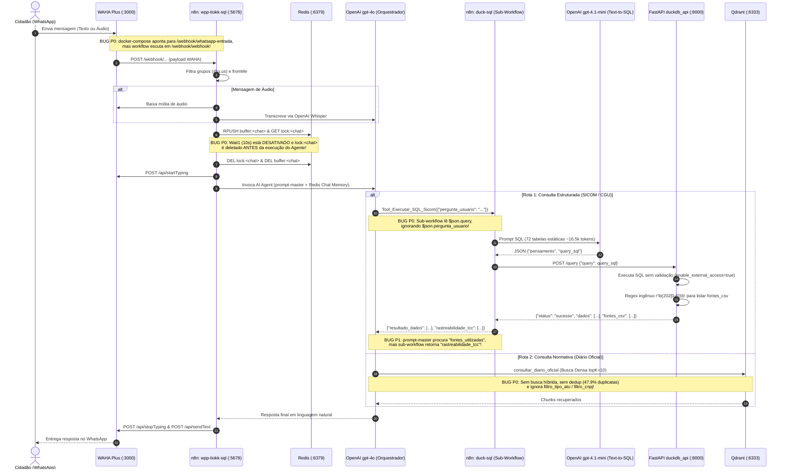
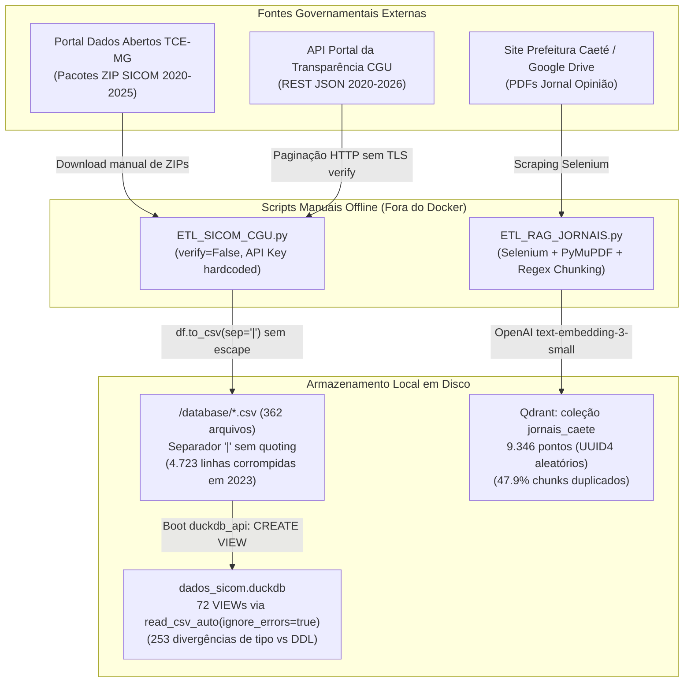

# PROJECT_MAP — Mapeamento Arquitetural e Operacional Completo do Sistema Atual (SIM)

Este documento apresenta a radiografia integral do **SIM (Sistema de Informações Municipais — Instância Piloto: Caeté/MG, IBGE `3110004`)**, cobrindo o estado real do código em `HEAD` (`100758b`), os artefatos de produção removidos no commit `55a2880` (recuperados em `AUDIT/historical_artifacts/`) e a camada experimental (`experimental/backend-v2/`).

---

## 1. Visão Geral e Discrepância Estrutural do Repositório

O repositório passou por uma reorganização no commit `55a2880` que separou os artefatos de avaliação acadêmica (`avaliacao/`, `docs/`) do código de aplicação, mas **quebrou a integridade operacional do ambiente de produção**:

| Componente | Localização em `HEAD` (`100758b`) | Localização Histórica (`55a2880~1`) | Estado Real |
|---|---|---|---|
| Orquestração Docker | `docker-compose.yml`, `Dockerfile` | `docker-compose.yml`, `Dockerfile` | **Quebrado em `HEAD`**: monta `./database:/data/export:ro`, mas `./database` foi movido para `avaliacao/dados/database`. |
| API Analítica (Produção TCC) | `scripts_python/main.py` | `scripts_python/main.py` | Funcional apenas se `./database` existir; cria `VIEW`s sobre CSVs a cada boot se `dados_sicom.duckdb` não existir. |
| API Analítica (Experimental v2) | `experimental/backend-v2/main.py` | `scripts_python/v2/main.py` | Adiciona materialização (`CREATE TABLE`), reparo de 2023 e paralelismo via `.cursor()`, mas mantém falhas críticas de segurança e regressão no `/ping`. |
| Workflows n8n (WhatsApp + SQL) | *Ausentes em `HEAD`* | `wpp-tiokk-sql.json`, `duck-sql.json` | Recuperados em `AUDIT/historical_artifacts/`. Contêm a lógica real do agente conversacional e do gerador Text-to-SQL. |
| Pipelines de Ingestão (ETL) | *Ausentes em `HEAD`* | `ETL_SICOM_CGU.py`, `ETL_RAG_JORNAIS.py` | Recuperados em `AUDIT/historical_artifacts/`. Documentam exatamente como os CSVs e a coleção Qdrant foram construídos. |
| Base Relacional Exportada | `avaliacao/dados/database/` (`362` CSVs) | `database/` (`362` CSVs + `.duckdb`) | Contém 72 tabelas lógicas distribuídas em arquivos anuais (`2020`–`2026`) separados por pipe (`|`). |
| Brutos SICOM e CGU | `avaliacao/dados/SICOM/`, `avaliacao/dados/staging_cgu/` | `SICOM/`, `staging_cgu/` | ZIPs anuais do TCE-MG (`2020`–`2025`) e CSVs brutos da API da Transparência CGU. |
| Pipeline de Avaliação Científica | `avaliacao/eval/`, `avaliacao/scripts/` | `eval/` | Reprodutível offline para SQL (`E1`–`E4`, `golden_dataset_v1.0.csv`) e online/offline para RAG (`golden_rag_v1.1.csv`, `golden_rag_v1.3.csv`). |

---

## 2. Segmentos de Dados, Bases e Fontes de Origem

O sistema integra **três fontes primárias de dados públicos** do município de Caeté/MG (IBGE `3110004`), divididas em **dois motores de armazenamento** (DuckDB para dados tabulares e Qdrant para textos normativos) e **11 segmentos temáticos**:

### 2.1. Bases Tabulares no DuckDB (72 Tabelas Lógicas / 362 Arquivos CSV)

| # | Segmento de Negócio | Origem Primária | Tabelas no DuckDB (`72` no total) | Cobertura Temporal | Volume / Características |
|---|---|---|---|---|---|
| 1 | **Estrutura Organizacional e Cadastros** | TCE-MG (SICOM) | `orgao_municipio`, `unidade_orcamentaria_municipio`, `pessoa_municipio`, `fornecedor_municipio` | 2020–2025 | Cadastros base; `pessoa_municipio` tem `393.368` linhas (com lacuna de nomes ligados à folha em 2020–2022). |
| 2 | **Orçamento e Planejamento (LOA / Créditos)** | TCE-MG (SICOM) | `lei_orcamentaria_municipio`, `decreto_municipal`, `alteracao_orcamentaria_municipio`, `natureza_despesa_municipio`, `natureza_receita_municipio`, `funcao_governo_municipio`, `subfuncao_governo_municipio`, `programa_governo_municipio`, `acao_governo_municipio`, `fonte_recurso_municipio` | 2020–2025 | Tabelas dimensionais de classificação funcional-programática e decretos de suplementação/remanejamento. |
| 3 | **Execução da Receita Pública** | TCE-MG (SICOM) | `receita_orcamentaria_municipio`, `detalhamento_receita_municipio`, `receita_intraorcamentaria_municipio` | 2020–2025 | Receita prevista vs. arrecadada líquida por natureza e fonte de recurso. |
| 4 | **Execução da Despesa (Empenho, Liquidação, Pagamento)** | TCE-MG (SICOM) | `empenho`, `empenho_fonte`, `anulacao_empenho`, `anulacao_empenho_fonte`, `reforco_empenho`, `reforco_empenho_fonte`, `liquidacao`, `liquidacao_fonte`, `nota_fiscal_liquidacao`, `anulacao_liquidacao`, `anulacao_liquidacao_fonte`, `pagamento`, `pagamento_fonte`, `pagamento_conta_bancaria`, `anulacao_pagamento`, `anulacao_pagamento_fonte`, `retencao_pagamento` | 2020–2025 | Núcleo financeiro. Em 2023, **8 tabelas deste segmento e de restos a pagar perderam 4.723 linhas** por corrupção de delimitador `|`. |
| 5 | **Restos a Pagar (RAP)** | TCE-MG (SICOM) | `restos_pagar`, `pagamento_restos_pagar`, `pagamento_restos_pagar_fonte`, `anulacao_pagamento_restos_pagar`, `cancelamento_restos_pagar`, `cancelamento_restos_pagar_fonte`, `liquidacao_restos_pagar`, `liquidacao_restos_pagar_fonte`, `anulacao_liquidacao_restos_pagar` | 2020–2025 | Controle de obrigações inscritas em exercícios anteriores (processados e não processados). |
| 6 | **Compras, Licitações, Dispensas e Atas** | TCE-MG (SICOM) | `processo_licitatorio`, `item_licitacao`, `licitante`, `proposta_licitacao`, `habilitacao_licitacao`, `julgamento_licitacao`, `homologacao_licitacao`, `adjudicacao_licitacao`, `dispensa_inexigibilidade`, `item_dispensa`, `adesao_registro_preco`, `item_adesao_registro_preco`, `empenho_licitacao`, `empenho_dispensa`, `empenho_adesao_registro_preco` | 2020–2025 | Fluxo completo de compras públicas e tabelas ponte (`empenho_licitacao`, `empenho_dispensa`) que ligam licitações à execução orçamentária. |
| 7 | **Contratos e Aditivos** | TCE-MG (SICOM) | `contratos`, `item_contrato`, `fornecedor_contrato`, `apostilamento_contrato`, `termo_aditivo_contrato`, `rescisao_contrato`, `empenho_contrato` | 2020–2025 | Gestão contratual e vínculo com empenhos (`empenho_contrato`). |
| 8 | **Folha de Pagamento e Recursos Humanos** | TCE-MG (SICOM) | `remuneracao_municipio` | 2023–2025 *(Lacuna 2020–2022)* | Remuneração bruta, descontos e líquida por servidor/mês. **Ausente nos pacotes públicos do TCE-MG de 2020 a 2022.** |
| 9 | **Patrimônio, Frota e Obras** | TCE-MG (SICOM) | `veiculo_publicacao_municipio`, `obra_municipio`, `bem_patrimonial_municipio` *(conforme pacote)* | 2020–2025 | Metadados de publicação e controle patrimonial. |
| 10 | **Transferências Federais e Convênios (CGU)** | Portal da Transparência (CGU API) | `cgu_convenios`, `cgu_emendas_parlamentares`, `cgu_recursos_recebidos`, `cgu_transferencias_constitucionais`, `cgu_renuncias_fiscais` | 2020–2026 | Recursos federais transferidos ao município ou entidades locais. |
| 11 | **Benefícios Sociais ao Cidadão (CGU)** | Portal da Transparência (CGU API) | `cgu_novo_bolsa_familia`, `cgu_auxilio_brasil`, `cgu_bolsa_familia_antigo`, `cgu_auxilio_emergencial`, `cgu_bpc`, `cgu_garantia_safra`, `cgu_peti`, `cgu_seguro_defeso`, `cgu_pe_de_meia` | 2020–2026 | Pagamentos individuais a beneficiários residentes em Caeté (`cpf_formatado`, `nis`, `nome`, `valor`). |

### 2.2. Base Vetorial / Textual no Qdrant (`jornais_caete`)
- **Origem**: Diário Oficial do Município de Caeté (*Jornal Opinião*), edições em PDF extraídas do portal oficial `caete.mg.gov.br`.
- **Armazenamento**: Qdrant v1.8.1, coleção `jornais_caete` (`9.346` pontos vetoriais de `1536` dimensões gerados por `text-embedding-3-small`, distância Cosseno).
- **Metadados do Payload**: `source` (nome do PDF), `ano_edicao`, `numero_edicao`, `tipo_ato` (`LEI`, `DECRETO`, `PORTARIA`, `EDITAL / LICITAÇÃO`, `EXTRato CONTRATUAL`, `TERMO ADITIVO`, `GERAL / OUTROS`), `cnpjs_Mencionados` (lista de CNPJs extraídos via regex), `page_content` (texto do chunk com cabeçalho injetado).

---

## 3. Processos de Coleta, Ingestão, Transformação e Atualização (ETL)

### 3.1. Pipeline Tabular (`ETL_SICOM_CGU.py` + `scripts_python/main.py`)
1. **Coleta CGU**:
   - Script `ETL_SICOM_CGU.py` consulta a API REST do Portal da Transparência (`https://api.portaldatransparencia.gov.br/api-de-dados/...`) iterando mês a mês (`202001` a `202612`) e páginas (`1..N`) com chave `chave-api-dados` hardcoded no script (`85d531036c6e595a93e6be7f6e61a449`) e `verify=False` (validação TLS desativada).
   - Salva CSVs intermediários em `staging_cgu/` (com checkpoint em `checkpoint_ingestao_json.txt`) e depois consolida por ano em `database/cgu_<tabela>_<ano>.csv` separados por pipe (`|`).
2. **Transformação SICOM**:
   - Lê arquivos `.zip` anuais (`SICOM/<ano>/*.zip`), extrai CSVs originais (separados por `;`, codificação `latin-1`/`utf-8`), converte cabeçalhos para minúsculas e regrava em `database/<tabela>_<ano>.csv` trocando `;` por `|` via `df.to_csv(..., sep='|', index=False)`.
   - **Falha crítica de transformação**: Não utiliza `quoting=csv.QUOTE_MINIMAL` nem escapa caracteres `|` presentes dentro de campos textuais (como `dsc_fonte_recurso` da EC 123/2022 em 2023), gerando linhas com excesso de delimitadores.
3. **Geração de Schema (`schema_gerado_llm.sql`)**:
   - Infere tipos apenas por prefixo do nome da coluna (`vlr_`/`val_` → `DECIMAL(18,2)`, `dat_`/`dt_` → `DATE`, `cod_`/`num_`/`ano_`/`mes_`/`id_` → `INTEGER`, demais → `VARCHAR`).
4. **Carga no DuckDB (`scripts_python/main.py`)**:
   - Na inicialização do container `duckdb_api`, se `dados_sicom.duckdb` não existir, agrupa os CSVs por prefixo e executa:
     ```sql
     CREATE OR REPLACE VIEW "<tabela>" AS
     SELECT * FROM read_csv_auto(['/data/export/<tabela>_2020.csv', ...],
       delim='|', header=true, all_varchar=false, union_by_name=true,
       ignore_errors=true, null_padding=true);
     ```
   - **Consequência dupla**:
     1. `ignore_errors=true` descarta silenciosamente as **4.723 linhas corrompidas de 2023**.
     2. `read_csv_auto` ignora o `schema_gerado_llm.sql` e infere tipos diretamente do CSV, criando **253 divergências de tipo** entre o que o prompt diz ao LLM e o que existe no DuckDB (ex.: 75 colunas `dat_*` anunciadas como `DATE` no prompt são `BIGINT` ou `VARCHAR` no banco; 150 colunas `DECIMAL`/`INTEGER` no prompt são `VARCHAR` no banco, como `cgu_novo_bolsa_familia.valor`).
5. **Mecanismo de Atualização**:
   - Totalmente manual e destrutivo: exige rodar `ETL_SICOM_CGU.py` fora do Docker, apagar `dados_sicom.duckdb` manualmente e reiniciar o container `duckdb_api`.

### 3.2. Pipeline Textual / RAG (`ETL_RAG_JORNAIS.py`)
1. **Coleta (Web Scraping)**:
   - Usa Selenium + Chrome headless para varrer `https://www.caete.mg.gov.br/jornal-opiniao/`, localizar links de PDFs no Google Drive ou no próprio domínio e baixá-los para `./jornais_caete_pdfs`.
2. **Extração e Limpeza**:
   - Usa `PyMuPDF` (`fitz`) página a página, remove hifenização de quebra de linha e quebras simples.
3. **Chunking Semântico Regido por Regex**:
   - Divide o texto quando encontra títulos em caixa alta de atos normativos (`PORTARIA Nº`, `DECRETO Nº`, `LEI Nº`, `EDITAL`, `EXTRATO DE`, `TERMO ADITIVO`, `AVISO DE LICITAÇÃO`, `SECRETARIA MUNICIPAL`).
   - Aplica `RecursiveCharacterTextSplitter(chunk_size=1500, chunk_overlap=250)` nos blocos resultantes e injeta cabeçalho `[FONTE: ... | CLASSIFICAÇÃO: ...]`.
4. **Indexação Vetorial**:
   - Gera embeddings via OpenAI `text-embedding-3-small` e faz upsert no Qdrant (`http://localhost:6333`, coleção `jornais_caete`) com UUIDs aleatórios (`uuid.uuid4()`), salvando apenas o nome do arquivo em `arquivos_processados_checkpoint.txt`.
   - **Falha crítica de idempotência**: Como os IDs dos pontos são `uuid4()` aleatórios, reexecuções parciais duplicaram quase metade da base (**4.474 chunks duplicados de 9.346 = 47,9%**).

---

## 4. Agentes, Modelos, Prompts e Responsabilidades

| Agente / Etapa | Modelo Configurado | Prompt Utilizado | Responsabilidade |
|---|---|---|---|
| **Agente Orquestrador Conversacional** (`wpp-tiokk-sql.json` / `orchestrator_master.txt`) | `gpt-4o` (`temp=0.2` no n8n) | `prompt-master` (raiz) / `avaliacao/eval/prompts/orchestrator_master.txt` (60 KB) | Receber a mensagem do cidadão, manter memória de curto prazo (Redis), decidir entre acionar `Tool_Executar_SQL_Sicom`, `consultar_diario_oficial` ou ambos, aplicar regras de transparência (lacuna 2020–2022, desambiguação de merenda/frota/obras) e formatar a resposta final com fontes. |
| **Agente Gerador Text-to-SQL** (`duck-sql.json` / `run_experiment.py`) | `gpt-4.1-mini` (`temp=0.0` no eval / `gpt-4o-mini` ou `gpt-4.1-mini` no n8n) | Em produção n8n (`duck-sql.json`): `prompt_sql_compacto.txt` (v1). No experimento Lote II: `prompt_sql_v2_insights.txt` (Prompt B, 67 KB). | Traduzir a pergunta em linguagem natural em um JSON `{"pensamento": "...", "query_sql": "SELECT ..."}` sobre as 72 tabelas do DuckDB, aplicando 77+ regras de negócio SQL. |
| **Motor de Embeddings RAG** | `text-embedding-3-small` (`1536` dims) | N/A | Vetorizar consultas ao Diário Oficial e chunks dos PDFs. |
| **Juiz LLM (Apenas Avaliação Offline)** | `gpt-4o` (`temp=0.0`) | `avaliacao/eval/prompts/judge_rubric.txt` | Avaliar equivalência semântica em experimentos legados (substituído nas métricas oficiais do TCC por `VSR` e `EF` determinísticos em `compare.py`). |

---

## 5. Fluxos de Execução Principais (Mermaid)

### 5.1. Fluxo de Execução de uma Pergunta (Produção Atual: WhatsApp → WAHA → n8n → DuckDB / Qdrant)



### 5.2. Fluxo de Ingestão e Atualização de Dados (Estado Atual)



---

## 6. Interfaces, Dependências Externas e Persistência

1. **Interfaces Existentes**:
   - **WhatsApp (via WAHA)**: Canal conversacional primário para o cidadão.
   - **Endpoints HTTP do `duckdb_api` (`:8000`)**:
     - `POST /query`: Executa SQL arbitrário no DuckDB e retorna JSON.
     - `GET /ping`: Dashboard HTML de monitoramento (exibe status, contagem de views, último JSON de consulta e console de logs ao vivo; **vulnerável a Stored XSS**).
     - `GET /api/logs`: Retorna as últimas 60 linhas de log em memória.
     - `GET /health` *(apenas no `experimental/backend-v2`)*: Sonda leve de saúde.
   - **Painel n8n (`:5678`)**, **WAHA Dashboard/Swagger (`:3000`)** e **Qdrant Dashboard (`:6333/dashboard`)**: Expostos sem autenticação ou com credenciais padrão fracas.
2. **Dependências Externas**:
   - **OpenAI API**: Modelos `gpt-4o`, `gpt-4.1-mini` / `gpt-4o-mini`, `text-embedding-3-small` e `whisper-1`.
   - **API Portal da Transparência CGU**: Ingestão de transferências e benefícios federais.
   - **Portal TCE-MG / Portal Prefeitura de Caeté**: Download de pacotes SICOM e edições do Diário Oficial.
3. **Mecanismos de Persistência**:
   - **DuckDB (`dados_sicom.duckdb`)**: Catálogo de `VIEW`s sobre CSVs (em produção) ou tabelas materializadas (em `experimental/backend-v2`).
   - **Qdrant (`./qdrant_storage`)**: Índice vetorial HNSW + payloads JSON em disco.
   - **Redis (`:6379`)**: Memória de conversação do n8n (`memoryBufferWindow`) e chaves efêmeras de buffer/lock. Sem volume persistente configurado no `docker-compose.yml` (perde estado ao recriar container).
   - **n8n (`./n8n_data`)**: Banco SQLite interno do n8n com credenciais, workflows e histórico de execuções.
